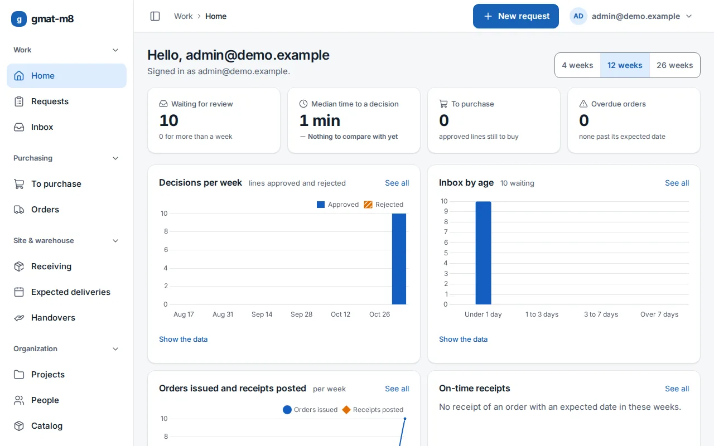
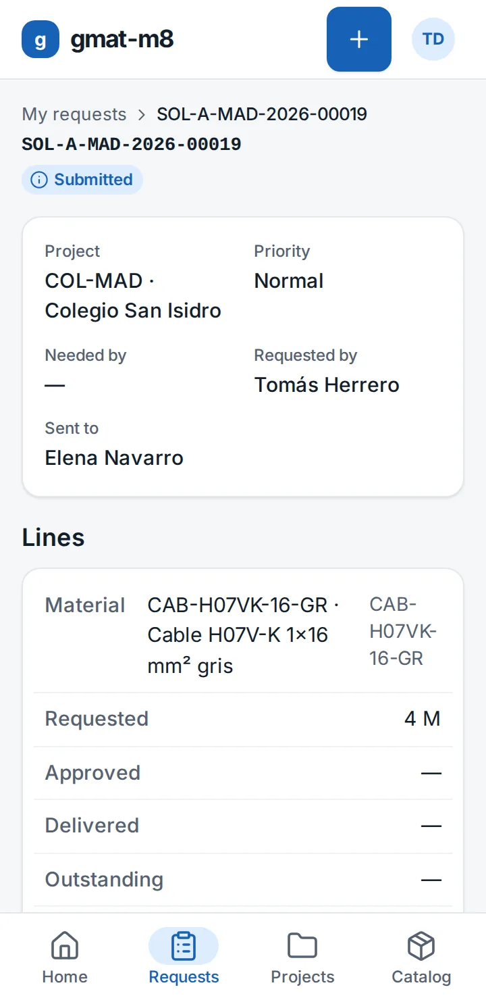

# gmat-m8


[](https://app.codacy.com/gh/mano8/gmat-m8/dashboard?utm_source=gh&utm_medium=referral&utm_content=&utm_campaign=Badge_grade)
[](https://codecov.io/gh/mano8/gmat-m8)
[](https://github.com/mano8/gmat-m8/blob/main/LICENSE)

**Know where every material is, from the request on site to the handover.**

gmat-m8 is a web application for any company that buys materials for its projects and worksites. Someone on site asks for what they need from their phone, a manager approves it, purchasing orders it from a supplier, and the goods are received and handed over. Every step is recorded, and each person sees only what concerns them.

It fits a single company with one office as well as a group of companies with several branches, partners and joint ventures, whatever the trade.





> **Status:** not released yet. The features below are built and tested, and the first version is being prepared. No image has been published so far, so for now you run it from this repository.

## How it works

1. **Request.** Choose materials from the catalog for a project, or describe one that is not in it. Set the priority and the date you need them by, then submit.
2. **Review.** A reviewer approves or rejects each line, corrects it, or sends the request back for changes. The original stays on record, so the requester sees what was changed.
3. **Purchase.** A worklist shows what is left to buy, grouped by material. Build purchase orders per supplier, then issue, print and, if you turn it on, email them. An issued order changes only through a recorded amendment.
4. **Receive.** Record a delivery from a phone, at a warehouse or on the worksite: what was accepted, what was rejected, any incident or surplus, and a photo of the delivery note.
5. **Hand over.** Hand materials from the warehouse to the people on the project. Goods received on site are handed over in the same step.
6. **Follow up.** For every line, see how much was approved, ordered, received and delivered. Dashboards, CSV exports and a full audit trail cover the rest.

## Who does what

| Role | What they do | What they see |
| --- | --- | --- |
| Group administrator | Runs the organization: companies, branches, people and their roles | Everything |
| Material manager | Reviews requests, buys, and manages projects, the catalog and suppliers | Their branch and the branches it manages, prices included |
| Engineer | The same as a material manager, and ranks above one | The same |
| Warehouse operator | Receives goods and hands them over | Orders and suppliers, without prices |
| Site manager | Requests and reviews materials for their projects, receives goods on site | Only their assigned projects: what is expected, no prices or supplier contacts |
| Technician | Requests materials and follows their own requests | Their own requests, the catalog and their branch's projects |
| Partner requester | Requests materials for projects shared with them | Their own requests; never prices, suppliers or anyone else's requests |

A person can hold several roles, each limited to its own branch or projects. Group administrators, material managers and engineers must sign in with a second factor.

## What you get

- **Quantities that add up.** What was received, delivered or is still pending is worked out from the documents and never stored, so it cannot drift. A delivery above what was ordered is recorded as surplus.
- **Made for the worksite.** The screens are designed for a phone first and work on a desktop too, in a light or a dark theme, in Spanish, English and French. Forms that act on a document open in a sheet on top of it, and the home page shows what needs you now, with charts beside their data. Accessibility is tested in a browser on every screen: see [ACCESSIBILITY.md](ACCESSIBILITY.md).
- **Records you can trust.** Posted receipts and handovers are never edited: they are voided with a reason and entered again. The audit trail is append-only.
- **Your existing data.** Import the catalog, suppliers and projects from CSV or Excel files, using the [templates](docs/import-templates/README.md). A file with any error writes nothing.
- **Security by default.** Access is checked on every page and every write. Uploaded files are scanned for malware before anything else happens to them, and images are decoded in an isolated container. Read more in [docs/security.md](docs/security.md).
- **Runs on one server.** Docker Compose on a single VPS, with signed images, deploys that can roll back, encrypted offsite backups and step-by-step [runbooks](docs/runbooks/README.md).

## Try it locally

You need Docker with Compose on an x86-64 machine, since the malware scanner's image exists only for x86-64. The stack needs about 4 GB of memory.

```bash
cd docker_compose/gmat_m8
bash init.sh                          # writes .env and app.env with generated secrets
docker compose up -d --build --wait   # https://localhost:8443 (accept or trust Caddy's local CA)

# the first administrator: prints a one-time setup link
docker compose run --rm web manage bootstrap_admin --email you@example.com --company-code A
```

Open the link, set a password and enroll a second factor. Email stays on your machine, in Mailpit, and never reaches a real inbox.

To explore with sample companies, people, projects and about 200 materials, use the development overlay instead; [the stack's README](docker_compose/gmat_m8/README.md) has the commands and the rest of the details. To run it on a real server, follow [the VPS guide](docs/runbooks/vps-setup.md).

## Built with

Python 3.14, Django 6.1, HTMX 2, Tailwind CSS 4 and PostgreSQL 18, as a modular monolith with no separate frontend and no API layer. Gunicorn, WhiteNoise and Caddy serve it, ClamAV scans uploads, and a worker process sends all email from a database outbox. The decisions behind this are recorded in [docs/adr](docs/adr/README.md).

## Development

You need Python 3.14, [uv](https://docs.astral.sh/uv/) and PostgreSQL 18.

```bash
uv sync

# PostgreSQL connection (the tests default to gmat / gmat / localhost:5432)
export DB_NAME=gmat DB_USER=gmat DB_PASSWORD=change-me DB_HOST=localhost DB_PORT=5432

uv run python manage.py migrate      # also creates the security cache table
uv run python manage.py runserver
```

`dev` settings use plain HTTP cookie names and derive a development-only MFA key, so no secret is needed locally. Accounts arrive through invitations: create the first administrator with `manage.py bootstrap_admin`, then sample data with `manage.py seed_demo --operator <email>`.

### Quality checks

```bash
uv run ruff format --check . && uv run ruff check .
uv run mypy .
uv run djlint --check templates apps
uv run python scripts/check_access_rules.py
uv run python scripts/check_security_floors.py
uv run python scripts/check_trivyignore.py
uv run python manage.py makemigrations --check --dry-run
uv run pytest --cov --cov-report=json:coverage.json && uv run python scripts/check_coverage_gates.py
# or faster, as CI runs it: the tests across your cores, then the time-sensitive ones alone
uv run python manage.py compilemessages
uv run pytest -n auto -m "not serial" --cov --cov-report= --cov-fail-under=0 && uv run pytest -m serial --cov --cov-append --cov-report=json:coverage.json && uv run python scripts/check_coverage_gates.py
```

Tests run on PostgreSQL only. Coverage stays at 90 % or more overall, and at 100 % for `apps/access` and every `services` and `selectors` module.

### Continuous integration

Every pull request runs these checks from [ci.yaml](.github/workflows/ci.yaml) and `compose-smoke.yaml`:

| Check | What it enforces |
| --- | --- |
| `lint` | ruff, djLint, the access rules and banned constructs, `uv lock --check`, security floors, valid and unexpired Trivy exceptions |
| `typecheck` | mypy (strict, django-stubs) |
| `security` | bandit (medium and above), pip-audit on the locked set, Trivy filesystem scan (HIGH and CRITICAL, no `--ignore-unfixed`) |
| `test` | the test suite in four jobs at once on PostgreSQL 18 (`test-shard`), no missing migrations, migrations that reverse; it merges their coverage and applies the gates |
| `trivy-image` | builds the app and backup images and gates both with Trivy |
| `secret-scan` | gitleaks over the full history |
| `compose-smoke-gate` | the whole stack, started fresh, against the live test suite, when a change can affect it |

After a green `test`, `coverage-upload` sends the report to Codecov and Codacy. It is not required: a pull request from a fork has no token for either, skips them and still passes.

Three more workflows run outside pull requests. `e2e.yaml` drives a real browser through the stack, on `main`, nightly, by hand or with the `e2e` label. `docker-publish.yaml` publishes both images, signed, when a `v*` tag is pushed, and refuses a commit that is not on `main` or lacks green checks. `image-scan.yaml` scans the released images and the third-party ones every night and keeps one issue up to date. See [docs/release.md](docs/release.md).

### Configuration

Settings live in `config/settings/`: `dev` (the default for `manage.py`), `test`, `prod` (the default for WSGI and ASGI, which refuses to start when a required variable is missing or weak) and `build` (static files at image build time, no database). The compose stack generates its values; [its templates](docker_compose/gmat_m8/app.env.production.example) list them all.

| Variable | Used by | Meaning |
| --- | --- | --- |
| `DB_NAME`, `DB_USER`, `DB_PASSWORD`, `DB_HOST`, `DB_PORT` | all | PostgreSQL connection (port defaults to 5432) |
| `DJANGO_SECRET_KEY` | `prod` (required, at least 50 characters), `dev` (optional) | Signing key |
| `DJANGO_ALLOWED_HOSTS` | `prod` (required, no wildcard), `dev` (optional) | Comma-separated host names |
| `DJANGO_DEBUG` | `dev` | Defaults to on in `dev`; refused in `prod` |
| `DJANGO_HSTS_SECONDS`, `DJANGO_HSTS_INCLUDE_SUBDOMAINS`, `DJANGO_HSTS_PRELOAD` | `prod` | HSTS, each off by default: turn them on once the domain is ready |
| `DJANGO_CSRF_TRUSTED_ORIGINS` | `prod` (required, `https://` only) | Comma-separated origins, e.g. `https://materials.example.org` |
| `MFA_ENCRYPTION_KEYS` | `prod` (required) | Comma-separated Fernet keys, newest first, separate from the secret key; see [docs/security.md](docs/security.md#mfa) |
| `DJANGO_SESSION_AGE_SECONDS` | all | Session lifetime for ordinary accounts (default 14 days) |
| `DJANGO_PRIVILEGED_SESSION_AGE_SECONDS` | all | Session lifetime for privileged accounts (default 12 hours) |
| `DJANGO_SESSION_IDLE_SECONDS` | all | Inactivity that ends a session of an ordinary account (default 2 hours) |
| `DJANGO_PRIVILEGED_SESSION_IDLE_SECONDS` | all | Inactivity that ends a session of a privileged account (default 30 minutes) |
| `ATTACHMENT_SCAN_SOCKET`, `ATTACHMENT_DECODER_SOCKET` | `prod` | The malware scanner's and the image decoder's sockets (the stack's fixed paths by default; a system check refuses them empty) |
| `SECURITY_CACHE_MAX_ENTRIES` | all | Capacity of the rate-limit cache (default 50,000; at capacity new keys get 429) |
| `DJANGO_LOG_LEVEL` | all | Root log level (default `INFO`); logs are JSON lines on stdout |
| `DJANGO_DEFAULT_FROM_EMAIL` | all | Sender address of account emails |

Generate an MFA key with `uv run python -c "from cryptography.fernet import Fernet; print(Fernet.generate_key().decode())"`.

Two health endpoints serve the stack's checks: `/healthz/` answers without touching the database, and `/readyz/` checks the database and answers 503, with no details, when it is down.

## Documentation

| Read | For |
| --- | --- |
| [docker_compose/gmat_m8/README.md](docker_compose/gmat_m8/README.md) | The stack: its services, networks and local tools |
| [docs/runbooks](docs/runbooks/README.md) | Running it: server setup, deploys and rollback, backups and restores, users, email, incidents |
| [docs/security.md](docs/security.md) | The threat model, the accepted exceptions and the security baseline |
| [docs/security-review.md](docs/security-review.md) | The record of every review pass |
| [docs/adr](docs/adr/README.md) | The architecture decisions and why they were taken |
| [docs/release.md](docs/release.md) | How images are built, signed and verified |

## Contributing

Start with [CONTRIBUTING.md](CONTRIBUTING.md). The architecture rules every change has to respect are in [CLAUDE.md](CLAUDE.md).

- [Code of Conduct](CODE_OF_CONDUCT.md)
- [Security policy](SECURITY.md): report vulnerabilities privately, never in a public issue
- [Accessibility](ACCESSIBILITY.md): what the interface supports and how to report a barrier

## License

[Apache License 2.0](LICENSE).
