# Design

Every view of gmat-m8 follows one reference. This directory holds it, the rule that binds the
interface to it, and pictures of where the application stands. The decision, its tokens and the
rules for vendored assets are in [ADR-0027](../adr/0027-ui-design-system.md).

## The reference

[`reference-mockups.html`](reference-mockups.html) is the set of mockups the maintainer approved
on 2026-11-08 ("use this format for all UI views"). It is documentation: the application never
serves it, so its web fonts and chart script (from CDNs, for a quick look in a browser) do not
touch the application's content security policy. Open it in a browser; its Light, Dark and System
switch shows both palettes.

| | Light | Dark |
| --- | --- | --- |
| Desktop, 1280 px | 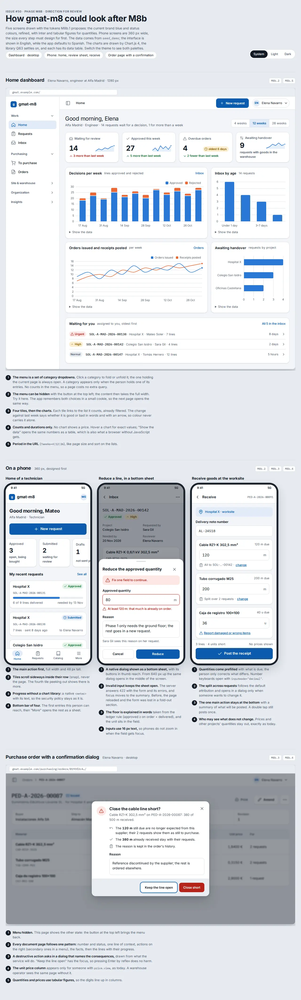 | 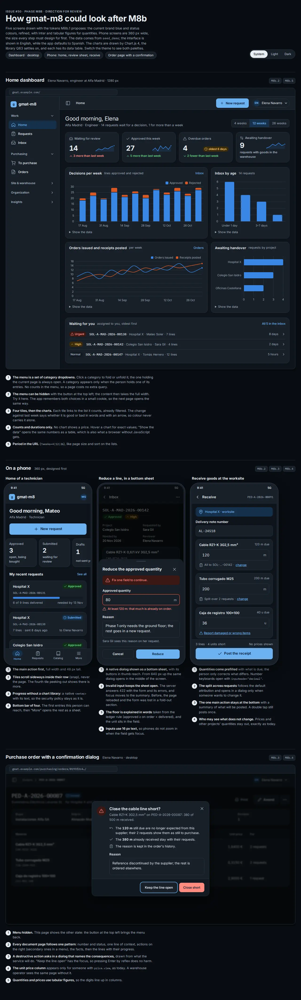 |
| Phone, 360 px | 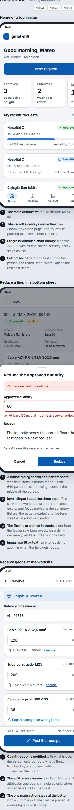 | 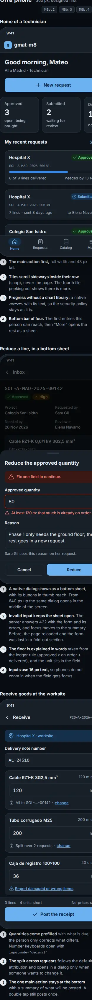 |

## What it fixes for all views

- **Shell:** a left menu of category dropdowns that can be hidden, a top bar (menu toggle,
  breadcrumbs, quick action, user menu), and on a phone a bottom bar of four entries plus More.
- **Pages:** a page header (the number or title, in the mono face for a document number; a status
  chip; one line of context; the actions on the right, the secondary ones in a menu), the facts as
  a definition-list card, lines as a table on a wide screen and as cards on a phone with progress
  meters, and the history as a timeline.
- **Dashboard:** a greeting with the period selector, four stat tiles (value, sparkline, the change
  in words with an arrow), chart cards with a title, a hint, a link and "Show the data", then the
  task list.
- **Dialogs:** a destructive confirmation centred on a desktop (a danger badge, the consequences as
  a list, a reason, Cancel focused, a footer on a sunken band) and a bottom sheet on a phone (a grab
  handle, a close button, the error summary on top, the two actions side by side).
- **Phone forms:** a context strip saying where the action happens, fields with 16 px text and the
  unit inside the input, and a sticky bottom bar with a one-line summary above the main action.
- **Details:** status chips with an icon and a word, tabular figures, radii of 9 to 16 px, soft
  elevation, a sunken tone for secondary bands, and both themes.

A screen the mockups do not draw is built from the same parts. A step that needs a pattern they
lack draws it in the style guide first and shows it in its pull request. **A visible departure
from the reference is a review finding.**

## The rule

- A new or changed view is built from the components in `templates/components/` (each with a header
  comment naming its arguments) and the classes in `static/src/app.css`. It is designed at 360 px
  first and only grows from there.
- A colour is a token. `uv run python scripts/check_contrast.py` checks both themes against
  WCAG 2.2 AA; `tests/unit/core/test_template_rules.py` rejects a raw colour, a `style` attribute,
  an inline script and a `max-*` layout variant.
- The pull request of a change to a view shows its 360 px screenshot before the desktop one.

## The style guide

`uv run python manage.py styleguide` draws every component in each variant and state to
`build/styleguide/index.html` (git-ignored; development and test settings only, no route). Build
the CSS first (`tailwindcss --input static/src/app.css --output static/dist/app.css`; the binary is
the one pinned in `docker/app/Dockerfile`). Add `--theme light` or `--theme dark`, or switch in the
page.

| | Light | Dark |
| --- | --- | --- |
| 360 px | 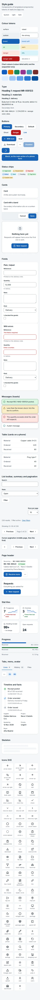 | 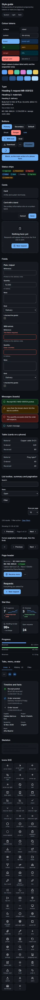 |
| 1280 px | 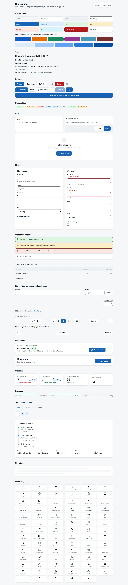 | 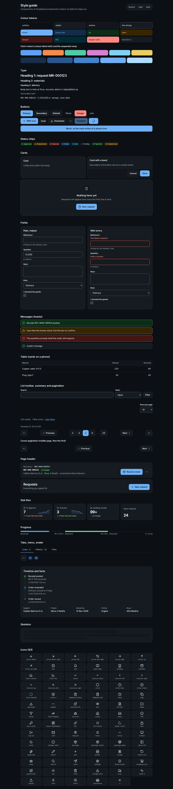 |

The screenshots show the component library at the end of the design-system step; the screens
themselves move onto it in the steps after. Regenerate them when a component changes shape.

## The app shell

The signed-in layout (`templates/layouts/app.html`, `apps/core/navigation.py`): a left menu of
category dropdowns that the person can hide, a top bar with the place, the quick action and the
account menu (language and theme in it), and on phones a bottom bar of four entries plus a More
sheet. Both choices and the folded categories are remembered in one cookie the server writes
(`/ui/preferences/`, see `docs/security.md`). The phone views come first, then the desktop ones
(phone: a page, the More sheet, the account menu; desktop: the menu shown, hidden, and the account
menu open).

| | Light | Dark |
| --- | --- | --- |
| 360 px | 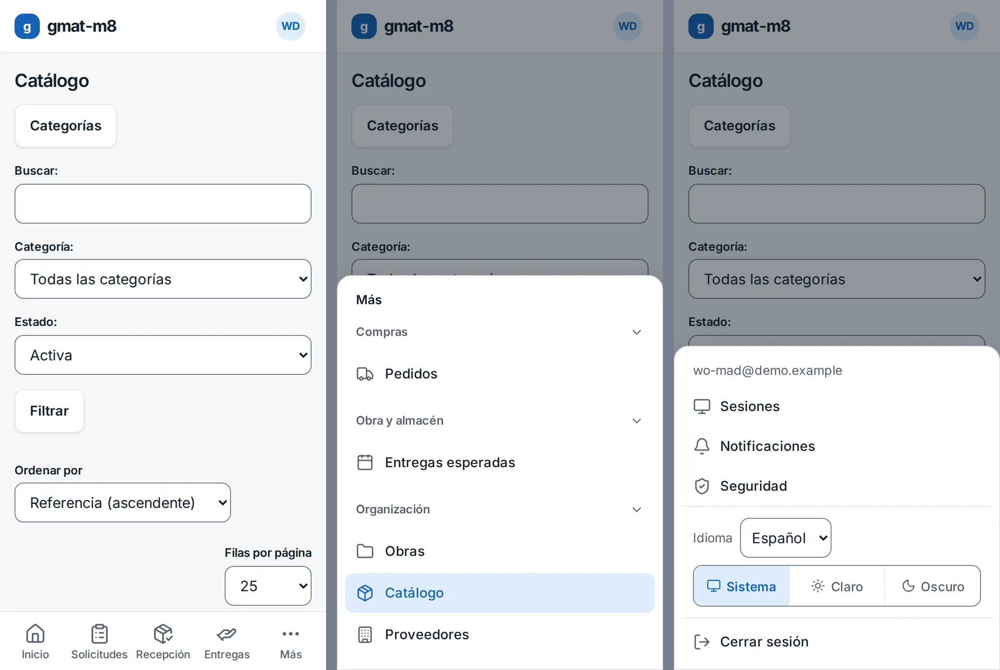 | 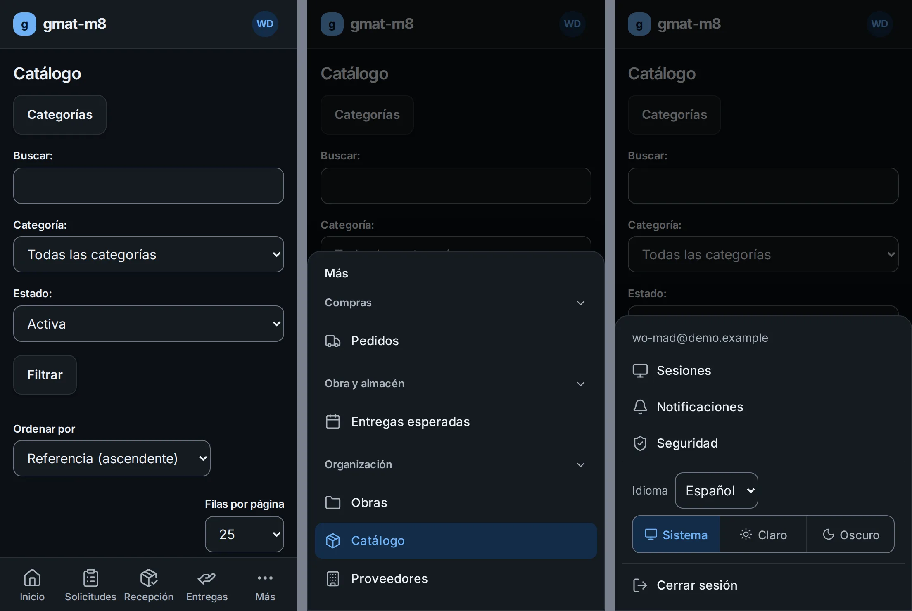 |
| 1280 px | 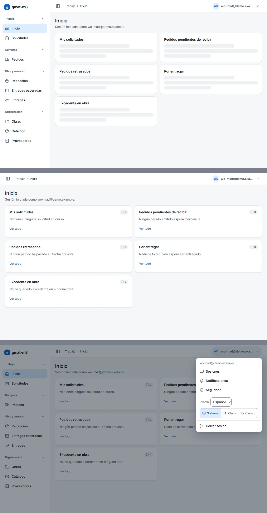 | 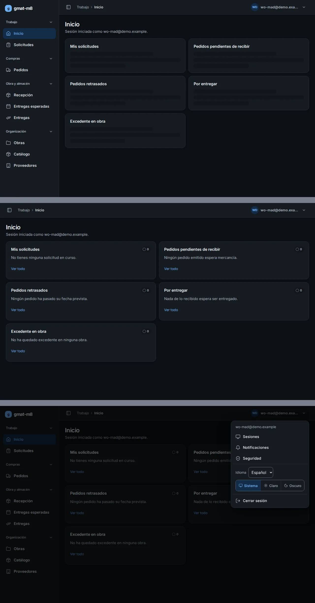 |

## Where actions open (M8b.4)

[`dialog-inventory.md`](dialog-inventory.md) lists every form that used to sit in a fold-out section
or on a page of its own, and how it opens now: an inline dialog, a lazy one, a form that stays, or a
disclosure that stays with its reason.
